# aws-cicd-platform

A multi-environment, AWS-native CI/CD platform: every push to `main` is built, tested, and
deployed to **dev**, then promoted to **prod** after manual approval using **blue/green
deployment with automatic rollback**.

The app is intentionally tiny. The platform around it is the project.


## Architecture

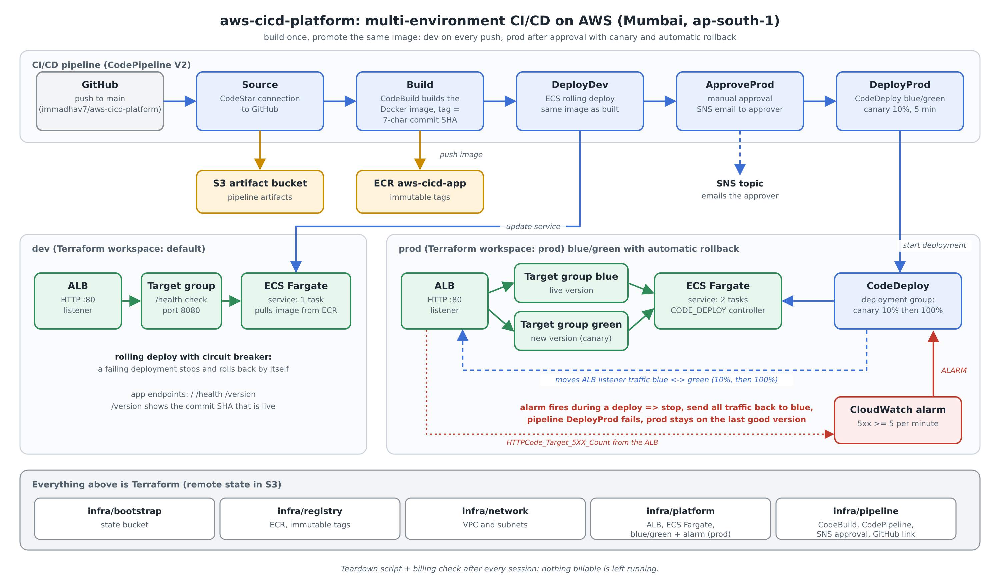

One pipeline builds the Docker image once, tags it with the 7-character commit SHA, and promotes the
same image: dev on every push, prod after a manual approval, deployed blue/green with a 10% canary.
A CloudWatch alarm on 5xx responses stops a bad prod release and rolls traffic back automatically.
Everything is Terraform (editable diagram source: `docs/architecture-overview.svg`).

## Target architecture

```
GitHub --> CodePipeline --> CodeBuild --> ECR
                |
                +--> Deploy (dev)  ECS Fargate + ALB
                +--> Manual approval (SNS email)
                +--> Deploy (prod) ECS Fargate + ALB, CodeDeploy blue/green
                                   rollback on CloudWatch alarm
```

Everything is created with Terraform. Config lives in SSM Parameter Store, secrets in
Secrets Manager.

## Repo layout

```
app/     Flask app (/health, /version), tests, Dockerfile
infra/   Terraform (bootstrap, registry, network, platform, pipeline; later alarms)
buildspec.yml  CodeBuild steps: test, build image, push to ECR tagged with the commit SHA
scripts/ push-image.sh (manual push), run-pipeline.sh (start the pipeline), approve.sh (approve or reject prod), check-versions.sh (what is live in dev and prod), load.sh, deploy-status.sh, fault.sh and demo-phase7.sh (the rollback demo), billing-check.sh, teardown.sh (destroys billable infra)
```

## Roadmap

| Phase | What | Status |
|-------|------|--------|
| 0 | Setup: AWS account/IAM user, budget alert, repo | In progress |
| 1 | Containerize the app | Done |
| 2 | Networking with Terraform (VPC, subnets, SGs, remote state) | Done |
| 3 | ECR + ECS Fargate + ALB, deployed manually | Done |
| 4 | CI with CodeBuild (test, build, push to ECR) | Done |
| 5 | CodePipeline for dev | Done |
| 6 | Multi-environment + manual approval | Done |
| 7 | Blue/green with CodeDeploy and automatic rollback | Done |
| 8 | Observability, diagram, README polish, teardown script | |

## Run the app locally

```bash
cd app
python -m venv .venv && source .venv/bin/activate
pip install -r requirements.txt
pytest
BUILD_ID=local python app.py        # http://localhost:8080/version
```

## Run with Docker

```bash
cd app
docker build -t aws-cicd-app:local --build-arg BUILD_ID=local .
docker run --rm -p 8080:8080 aws-cicd-app:local
curl localhost:8080/health
curl localhost:8080/version
```

`/version` returns the build ID (the commit SHA in the pipeline). It is how we prove which
version is live after a deploy or a rollback.

## Pipeline (dev)

A push to `main` starts **CodePipeline**:

1. **Source**: GitHub, through a CodeStar connection (authorized once in the console).
2. **Build**: CodeBuild runs `buildspec.yml`: unit tests, `docker build`, `docker push` to ECR
   tagged with the 7-character commit SHA, then writes `imagedefinitions.json`.
3. **DeployDev**: the ECS deploy action registers a new task definition revision with that
   image and updates the Fargate service behind the ALB.

Design notes:

- ECR tags are immutable and SHA-based, so every running version maps to exactly one commit.
  Rebuilding a commit that already has an image reuses it instead of failing.
- `BUILD_ID` is baked into the image, so `/version` always reports the commit that is live.
- Terraform ignores the service's task definition after creation (`ignore_changes`), so a
  `terraform apply` never reverts a deploy made by the pipeline.
- IAM is least privilege per service: CodeBuild can push to one repository, CodePipeline can
  update one ECS service and pass one role.

### Screenshots

**Before: /version reports the manually pushed image (v1)**

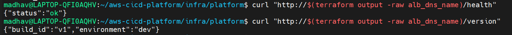

**Terraform creates the pipeline; the GitHub connection is authorized**

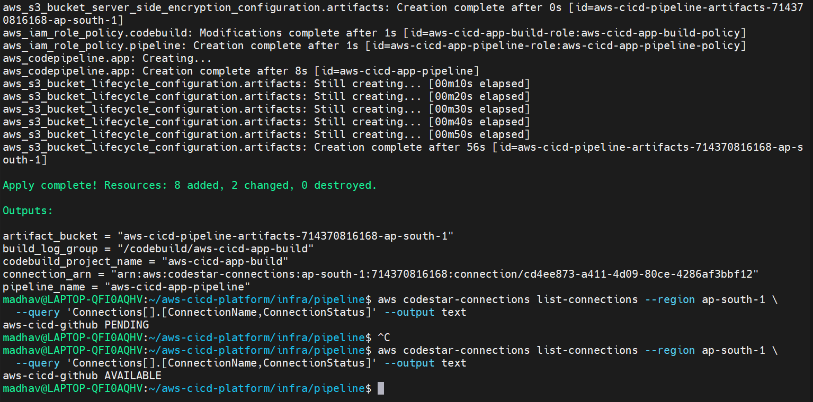

**CodePipeline: Source, Build and DeployDev all succeeded**

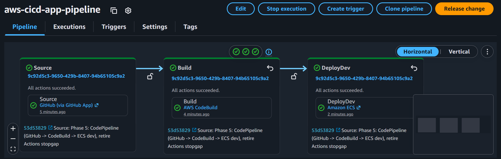

**CodeBuild writes imagedefinitions.json for the ECS deploy action**

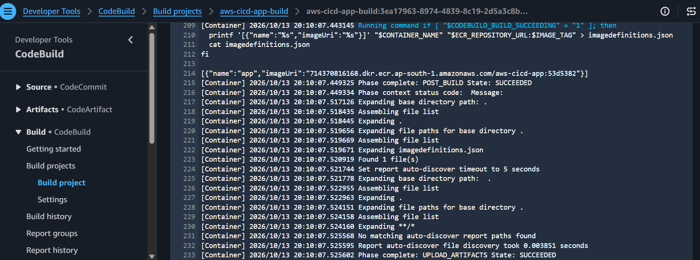

**ECR repository with immutable tags**

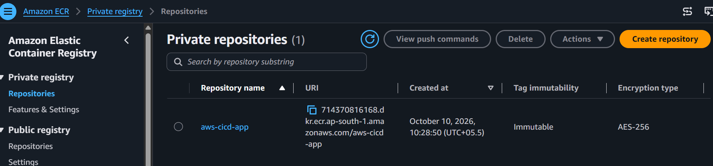

**Images tagged with the commit SHA**

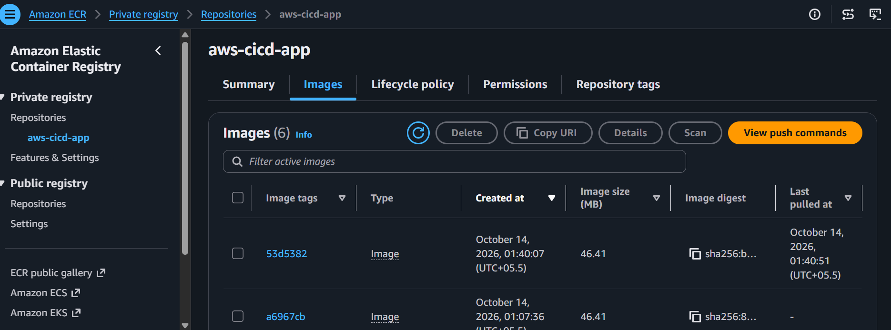

**After: the pipeline deployed the new commit and /version reports it**

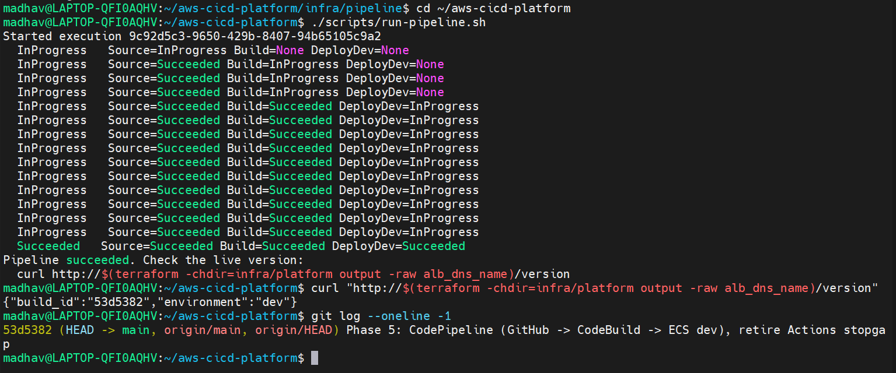

**ALB target group with a healthy target**

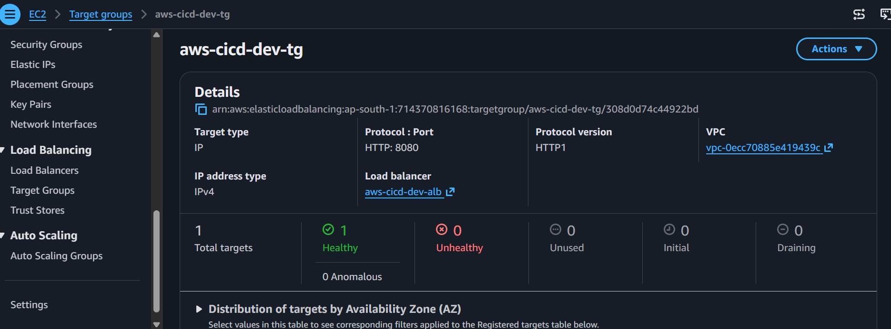

**AWS approved the CodeBuild quota increase**

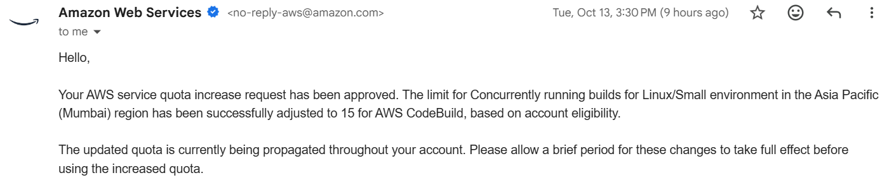

## Environments and manual approval (dev and prod)

```
Source -> Build -> DeployDev -> ApproveProd (email) -> DeployProd
```

- **One image, promoted.** The image is built once and tagged with the commit SHA. Prod gets
  exactly the image that ran in dev; nothing is rebuilt between environments.
- **Environments are Terraform workspaces** of the same `infra/platform` code: `default` is dev,
  `prod` is prod. Each has its own state, ALB, ECS cluster, service and IAM role. Dev runs one
  task, prod runs two. (One account keeps this cheap; for stronger isolation I would use a
  separate AWS account per environment.)
- **Manual approval.** CodePipeline publishes to an SNS topic, which emails the approver.
  Approve in the console or with `./scripts/approve.sh`; `./scripts/approve.sh reject` stops the
  release and `DeployProd` never runs.
- `./scripts/check-versions.sh` shows what is live in each environment, so the gate is visible:
  dev runs the new commit while prod stays on the old one until someone approves.

**Both environments created from the same Terraform code (prod is still warming up)**

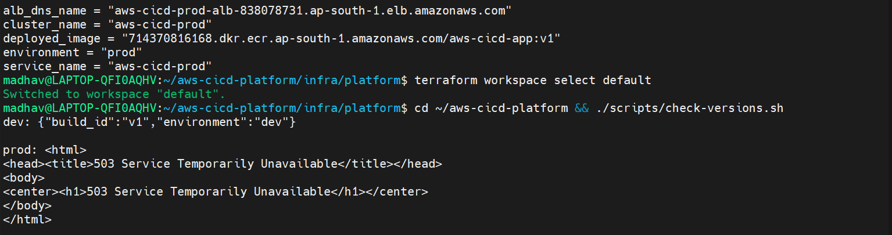

**Separate ECS clusters: dev runs 1 task, prod runs 2**

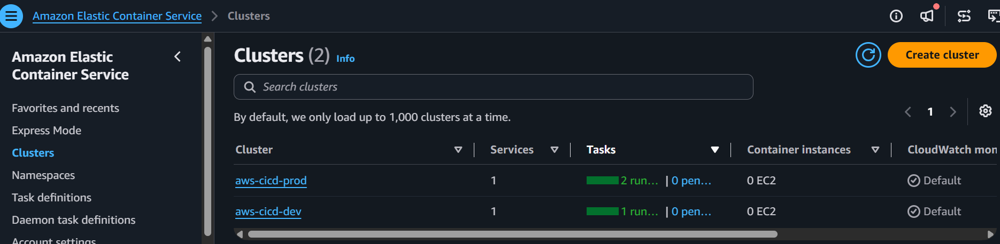

**SNS asks the approver to confirm the email subscription**

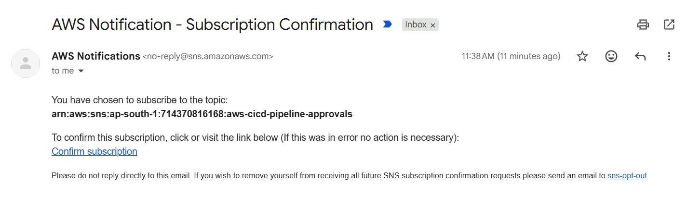

**Subscription confirmed**

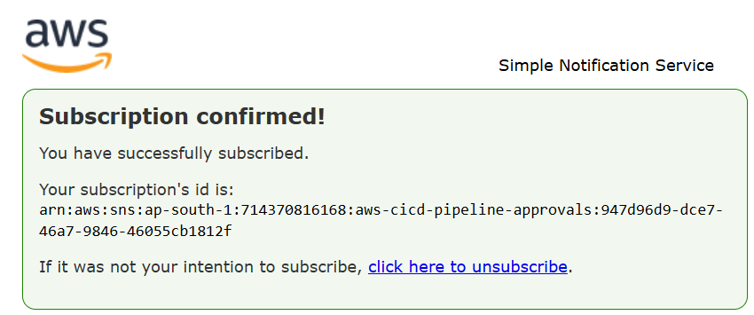

**The approval gate at work: dev already runs the new commit, prod still runs v1**

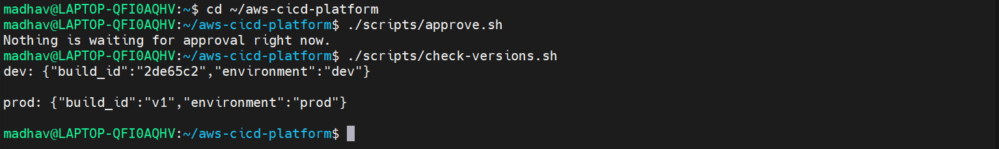

**Pipeline: Source, Build, DeployDev, ApproveProd, DeployProd**

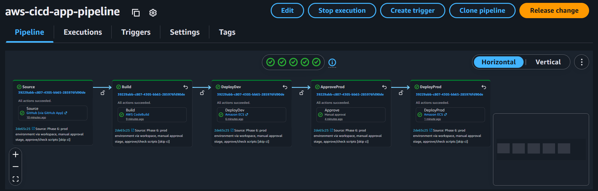

## Blue/green deploys with automatic rollback (prod)

```
Source -> Build -> DeployDev -> ApproveProd -> DeployProd (CodeDeploy blue/green, canary)
```

- **Blue/green.** CodeDeploy starts the new version in a second target group next to the running
  one, sends 10% of the traffic to it, waits 5 minutes, then sends the rest. The old tasks stay
  around for a minute before they stop. Dev keeps the plain ECS rolling deploy.
- **Automatic rollback.** A CloudWatch alarm watches the 5xx responses the app returns. If it fires
  while a deployment runs, or the deployment fails, CodeDeploy moves all traffic back to the old
  version by itself and the pipeline's `DeployProd` action fails. Nobody has to react.
- **Why 5xx and not just health checks.** A bad release often passes `/health` and still breaks real
  requests. The demo flips `SIMULATE_FAULT` in `deploy/taskdef.json`: `/health` stays green, the home
  page returns 500. The health check would have let it through; the alarm catches it.
- **How to see it.** `./scripts/demo-phase7.sh` runs the whole thing (good deploy, broken deploy,
  rollback, teardown). `./scripts/deploy-status.sh` shows the last deployment and why it ended.
- **Known limits.** `deploy/taskdef.json` repeats the settings of the Terraform task definition, so
  the two must be kept in step. The alarm only sees traffic that reaches the ALB, which is why the demo
  sends requests while the canary runs. After a rollback the alarm needs a couple of minutes to clear
  before the next deploy can start.

**CodeDeploy deployment group: blue/green, alarm and automatic rollback enabled**

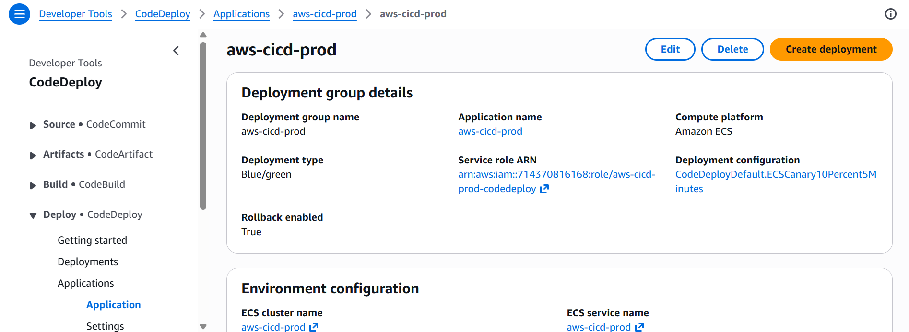

**Prod answers with both versions while the traffic shifts**

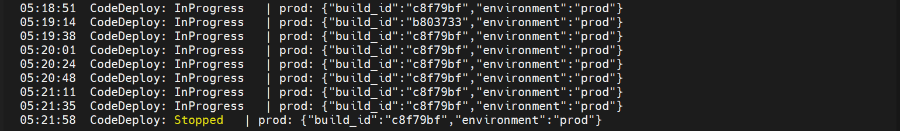

**Good deploy finished: 100% on the new version**

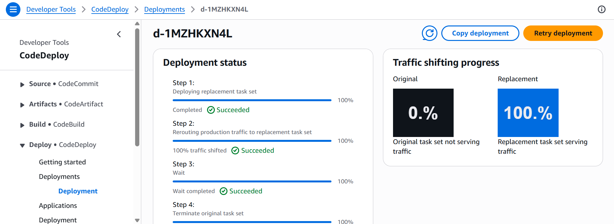

**Pipeline: DeployProd now runs through CodeDeploy**

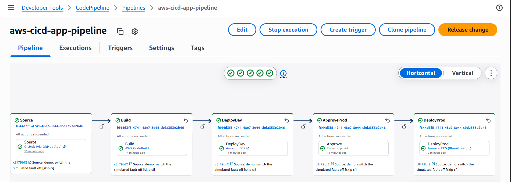

**Broken deploy: CodeDeploy stopped it because the alarm fired, and rolled back**

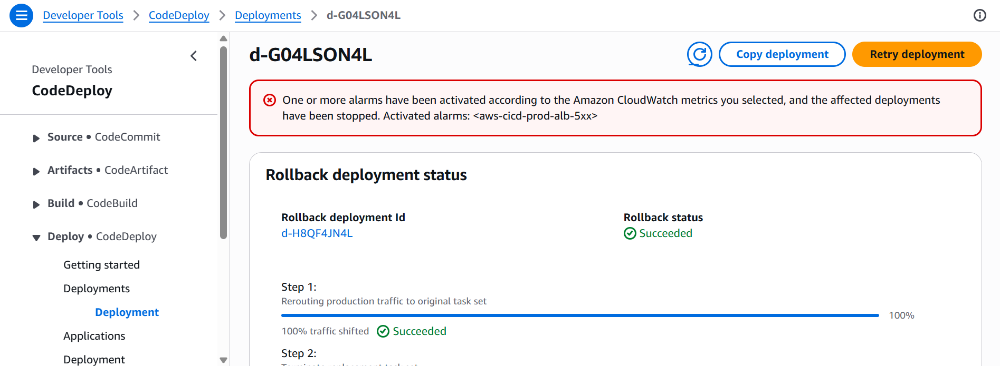

**The 5xx alarm that triggered the rollback**

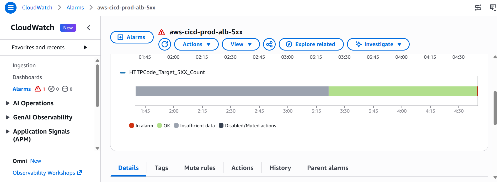

**Pipeline after the rollback: DeployProd failed, prod untouched**

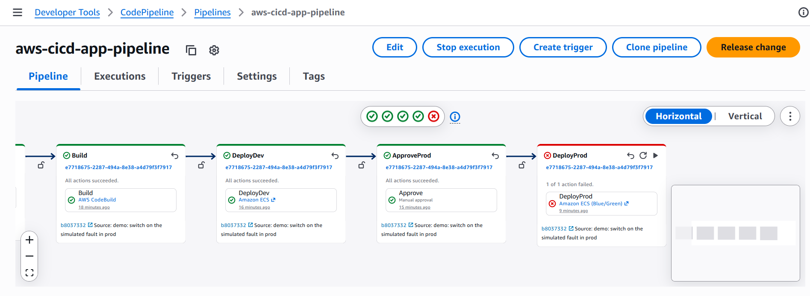

## Problems solved along the way

- **CodeBuild quota was 0** on a new account. I requested an increase (approved: 15 concurrent
  builds) and meanwhile built a GitHub Actions stopgap that pushes to ECR through **OIDC with no
  stored AWS keys**. It was removed once CodeBuild worked.
- **GitHub changed the OIDC subject claim** to include numeric owner and repository IDs
  (`repo:owner@id/name@id:...`). The role's trust policy rejected the token until it accepted
  that form too. I found it by decoding the token claims in a debug step.
- **Immutable tags vs re-runs**: re-running a build for the same commit used to fail at
  `docker push`; the build now checks ECR first and reuses the image.

## Cost control

The ALB, NAT gateway, and Fargate tasks cost money while running. Run `terraform destroy`
after every working session.

CodeBuild quota approved (15 concurrent Linux/Small builds, ap-south-1).
